# TGMusic

把一个 YouTube Music 账号的收藏或指定歌单中的新增歌曲发到 Telegram 私聊或已授权群组。GitHub Actions 负责浏览器和音频处理，Cloudflare D1 保存发送状态，私有 R2 保存加密登录档案，Cloudflare Worker 接收指令，Infisical Cloud 管理密钥。

每个聊天分别核对成功发送记录，补发歌单中未发送的歌曲；旧的首次基线不再跳过。目标默认优先音频，但只有 `AUDIO_AUTHORIZED_VIDEO_IDS` 明确列出的、允许下载和重新分发的歌曲才会尝试获取文件，其余发送原链接。链接和音频在历史中分别记录。

实现来自 [Issue #1](https://github.com/C0verSnow/TGMusic/issues/1) 的最新整合需求和随笔。参考项目、选择原因与已知限制见 [设计说明](docs/design.md)，逐项验收见 [验收清单](docs/acceptance.md)。

## 运行流程

```mermaid
flowchart LR
  A[Actions + Infisical] --> B[恢复 R2 加密档案]
  B --> C[直连检查 / Mihomo 美国备用出口]
  C --> D[DrissionPage 检测登录]
  D --> E[读取全部收藏分页]
  E --> F[D1 按聊天核对未发送歌曲]
  F --> G[Telegram 音频或链接]
  G --> H[R2 回执 + D1 逐首保存]
  H --> I[更新 R2 和仓库 docs/latest.md]
  I --> J[退出浏览器后加密备份]
  J --> K[无未发送歌曲才回复同步完成]
```



## 首次部署

### 1. 准备 Cloudflare

1. 建立私有 R2 桶，例如 `tgmusic-private`。不要启用公开访问或公开域名。R2 有免费额度，但首次开通会要求接受按量计费订阅。
2. 建立 D1 数据库 `tgmusic`，把 UUID 写进 `worker/wrangler.toml` 的 `database_id`；填写桶名。
3. 创建 R2 对象读写凭证，只授权这一个桶。另建 Cloudflare API Token，只授予对应账号的 D1 Edit。同步程序不需要 Cloudflare 全局 API Key。
4. 在 Cloudflare 控制台执行 `migrations/0001_initial.sql`，或在具备 Cloudflare 授权的部署环境执行：

   ```sh
   npx wrangler@4.45.0 d1 migrations apply tgmusic --remote --config worker/wrangler.toml
   ```

迁移只创建表，不会把丢失状态自动当成首次运行。部署命令应在你自己的部署环境或远端执行；本仓库约定禁止本地编译验证。

### 2. 准备 Infisical

当前使用已有 **Example Project** 的机器身份，保留 dev / staging / prod 环境。在 prod 的 `/tgmusic` 下按用途建文件夹：

| 目录 | 放什么 |
|---|---|
| `/tgmusic/shared` | 预留共享配置目录；当前运行所需定位参数直接保存在 github-actions 目录 |
| `/tgmusic/github-actions` | R2 凭证、D1 API Token、PROFILE_ENCRYPTION_KEY、Telegram Token/Owner/默认私聊 ID、浏览器及同步配置、备用 Mihomo YAML |
| `/tgmusic/cloudflare-worker` | Telegram Token、Owner ID、Webhook Secret、GITHUB_WORKFLOW_TRIGGER_TOKEN |

完整键名见 [.env.example](.env.example)。示例文件不是实际密钥，不要提交 `.env`、浏览器目录或 Mihomo 节点配置。

用户已选择复用 Example Project 现有的 Machine Identity，解决新增身份额度限制。TGMusic 按 `/tgmusic/github-actions` 读取，密钥名保持不变，无需添加 TGMUSIC_ 前缀或转换代码。这些文件夹用于区分应用；共用身份仍共享同一套权限，不声称仓库之间已实现权限隔离。Worker 的 Cloudflare Workers Secret Sync 源路径使用 `/tgmusic/cloudflare-worker`；Infisical 连接 Cloudflare 的集成凭证仍限制在本 Worker 所需权限。

`PROFILE_ENCRYPTION_KEY` 是 Fernet 密钥，可在可信配置环境运行下面的密钥生成命令，并直接保存到 Infisical，勿贴到公共日志：

```sh
python -c 'from cryptography.fernet import Fernet; print(Fernet.generate_key().decode())'
```

`TELEGRAM_OWNER_ID`、`TELEGRAM_DEFAULT_CHAT_ID` 均为数字 ID。首次默认目标必须是已对 Bot 发过 `/start` 的私聊；群组以后用 `/addtarget` 授权。

### 3. 初始化数据与登录档案

先在可信的配置环境使用 Infisical 注入完整配置，显式初始化一次：

```sh
python src/infisical_boot.py src/manage.py bootstrap
```

初始化会在 R2 和 D1 写同一安装标识、建立 D1 Owner 和默认目标。只有这里可以创建首次运行状态。若中途失败，保留现场，核对 R2 `sync/installation.json` 与 D1 `installation`，不要重置生产历史。空安装可在明确确认没有发送历史后手工修复初始化；正常运行不会替你清空数据。

Google 首次登录需要人工完成。使用**有桌面的 Linux 环境**、独立浏览器用户目录，以及与 Runner 兼容的 Chrome 版本。设 `BROWSER_HEADLESS=false` 和实际 `BROWSER_PATH`，运行：

```sh
python src/infisical_boot.py src/manage.py login
```

在打开的独立 Chromium 窗口登录 Google，进入 YouTube Music，回到终端按回车。程序验证登录、关闭浏览器，再加密上传档案。不要导入日常 Chrome 的整个个人档案。macOS/Windows 的 Cookie 加密通常不能直接迁移到 Linux Runner；此步骤应在 Linux 完成。

没有远程桌面的 Xvfb 只提供虚拟显示，不能代替人工完成 Google 登录、验证码或二次验证。Google 在新出口上可能再次要求验证，这属于部署验收的一部分。

#### 在本机通过 Docker 完成人工登录

macOS/Windows 可使用仓库提供的预构建 Linux Chromium，不需要在宿主系统导出 Cookie，也不需要构建 Docker 镜像。先启动 Docker，并完成 `infisical login`；仓库 `.env` 填写 Example Project 的 `INFISICAL_PROJECT_ID`、环境和目录。程序先读取 `.env` 中的定位参数，再通过 Infisical CLI 读取 prod `/tgmusic/github-actions` 的 R2 配置和加密密钥。

```sh
bash scripts/docker-login.sh --ini config/browser.ini
```

打开终端提示的 `http://127.0.0.1:3000`，在里面亲自登录 Google，并进入 YouTube Music；密码、验证码和二次验证由本人填写。登录有效后，程序自动停止浏览器容器，把**完整 ini 和完整 Chromium User Data 目录**一起归档，再加密上传私有 R2。该目录内的缓存、Local Storage 和空目录都保留，只排除 Chromium 的运行锁及调试端口文件。Linux 按 XDG 规则放在 User Data 目录外的网页磁盘缓存不属于本归档范围；不是整个容器 `/config` 的备份。端口被占用时可加 `--port 3001`。

成功后清理本次明文用户目录，加密副本留在 `.runtime/docker-login/google-profile.latest.enc`。如果关闭浏览器后的上传失败，保留现场，修复配置后执行：

```sh
bash scripts/docker-login.sh --upload-only
```

重传使用原来的 `--ini` 和 `--state-dir`，期间不要修改 ini。若提示云端档案版本冲突，先核对是否有其他任务更新了档案，不要反复重传覆盖。此登录入口需要 `R2_ENDPOINT`、`R2_BUCKET`、`R2_ACCESS_KEY_ID`、`R2_SECRET_ACCESS_KEY`、`PROFILE_ENCRYPTION_KEY`；可选 `R2_PROFILE_OBJECT`。它不要求先解决 Actions 机器身份额度，也不代表整个同步服务已经上线。

Wrangler CLI 优先用于云资源管理。核对过的 Wrangler 4.160.1 对象上传命令没有条件覆盖和自定义元数据参数，因此档案仍使用已有 boto3 S3 客户端，保留 ETag 条件覆盖、校验元数据和独立加密版本。原因与官方问题链接见[设计记录](docs/design.md#docker-登录与上传方式)。

### 4. 配置 GitHub

Repository Secrets 只保存：

- `INFISICAL_CLIENT_ID`
- `INFISICAL_CLIENT_SECRET`

同步工作流须先进入默认分支，才能首次从 Actions 页面或 Worker 手动触发；只在功能分支存在还不够，见 [GitHub 官方触发规则](https://docs.github.com/en/actions/reference/workflows-and-actions/events-that-trigger-workflows#workflow_dispatch)。PR #2 已合并，手动触发入口已具备；验收期间保持定时关闭。

Repository Variables 设置 Example Project 的项目 ID、环境 prod、路径 `/tgmusic/github-actions`、API 地址。其他运行参数放 Infisical。`TGMUSIC_ENABLED` 只控制定时任务；手动任务可在它为 `false` 时运行，Worker 发起的手动任务也一样。

在 Actions 的 **YouTube Music Sync → Run workflow** 选择要验收的分支：

1. 首次安装且已核对 D1/R2 都没有安装标识或历史时，选择 `operation=bootstrap`，`target_chat_ids` 留空。它只调用现有显式初始化命令，不启动浏览器或发送收藏；已有或残缺的安装会报错，不能反复初始化来修复失败。
2. 选择 `operation=sync`，验收 Infisical 注入、R2 档案恢复、Google 登录、完整收藏分页和按聊天补发。此时定时仍可保持关闭。
3. 再在新 Runner 执行一次 `sync`，确认历史和登录档案可恢复、成功发送的歌曲没有重复发送。新增一首收藏后，再验证新增发送与再次运行不重复。
4. 完成部署验收后才设 `TGMUSIC_ENABLED=true`。手动 `sync` 使用正式发送流程；已初始化的目标出现新增时会实际发送，不是只读检查。

cron 每 6 小时运行一次（UTC 00:17、06:17、12:17、18:17）；Telegram `/sync` 或 Actions 手动运行会立即请求额外的一次同步，不改变固定定时时刻。GitHub cron 使用 UTC，夏令时只会改变当地显示时间。旧的 `SYNC_INTERVAL_MINUTES` 不再使用，可从 Infisical 移除；调度以 `.github/workflows/sync.yml` 为准。Admin 在私聊只触发其授权目标，在群组只触发当前群组；Owner 在私聊可触发全部目标。局部同步不推迟其他目标的定时任务。GitHub 定时可能延迟，不保证精确时间。未设置 `TGMUSIC_ENABLED=true` 时定时任务跳过，防止配置未齐就自动运行。

工作流使用 Python 3.12、Node 22；锁定 DrissionPage 4.1.1.4、Mihomo 1.19.34、Infisical CLI 0.45.6、yt-dlp 2026.10.26 和 yt-dlp-ejs 0.8.0。二进制安装脚本核对仓库内固定的 SHA-256。同步 job 使用短期 `GITHUB_TOKEN` 的 `contents: write`，仅自动提交 `docs/latest.md` 到当前运行分支；CI 仍为 `contents: read`，30 分钟超时，同一并发组不取消正在进行的任务。

音频回退为链接时，可在 Run workflow 选择 `operation=check-audio`，填写已在 `AUDIO_AUTHORIZED_VIDEO_IDS` 授权的 `video_id`。它在远端恢复真实档案并调用正式音频解析、下载与转码，只输出正式解析是否成功、音频格式和文件大小，不发送消息、不修改歌曲历史，也不上传登录档案。检查失败与正常同步的链接回退要分开看。

### 5. 部署 Worker

在 `worker/wrangler.toml` 填好 D1 UUID、R2 桶和 Bot 用户名，在有授权的部署环境执行：

```sh
npx wrangler@4.45.0 deploy --no-bundle --config worker/wrangler.toml
```

Worker 是原生 JavaScript，`--no-bundle` 直接上传源码，跳过本地构建。随后在 Infisical 为该 Worker 配置 Cloudflare Workers Secret Sync，从 prod `/tgmusic/cloudflare-worker` 同步四个敏感键。使用单独且最小权限的集成连接；不要在仓库写 Worker Secrets。`GITHUB_WORKFLOW_TRIGGER_TOKEN` 是只允许本仓库 Actions Write 的细粒度令牌，用于触发 `sync.yml`，不能用工作流里只读的 `GITHUB_TOKEN` 替代。

在可信配置环境注入 Telegram Token 和 Webhook Secret 后注册：

```sh
python src/infisical_boot.py src/manage.py set-webhook https://你的Worker域名/webhook
```

此命令还读取管理配置，可将 Webhook Secret 临时作为配置环境变量注入，勿通过命令行传秘密。Worker 收到请求后快速返回，后台处理权限和触发任务，不运行浏览器或下载音乐。

## 指令与授权

| 指令 | 用法 | 谁能用 |
|---|---|---|
| `/start` `/help` | 帮助 | 所有人 |
| `/status` | 最近同步与目标状态 | Owner / Admin |
| `/sync` | 核对并补发未发送歌曲，更新清单后回报结果 | Owner / Admin |
| `/targets` | 查看目标；Admin 只看到授权范围 | Owner / Admin |
| `/addtarget` | `/addtarget -1001234567890 audio`；也可 link | Owner，且须为该群管理员 |
| `/removetarget` | `/removetarget -1001234567890`；保留历史 | Owner |
| `/enable` `/disable` | 当前目标，或指定数字 chat_id | Owner / 有该目标授权的 Admin，群组还需群管理员身份 |
| `/authstatus` | 最近一次 Google 登录检查 | Owner |
| `/health` | D1、R2 档案、任务状态 | Owner |

Bot 入群不会自动订阅。Bot 需具备发送权限，并建议设为群管理员以可靠查询其他成员的管理员身份。系统 Admin 与 Telegram 群管理员是两个独立条件。授权名单保存在 D1，以数字 User ID 认证，不使用用户名认证。每个用户在同一聊天的管理命令间隔至少 10 秒；Webhook update_id 去重；管理请求写脱敏审计记录。

管理员授权通过可信配置环境操作，不开放 Guest 自助提权：

```sh
python src/infisical_boot.py src/manage.py grant-admin 123456789 -1001234567890
```

## 发送、失败与恢复

- D1 主键是 `(chat_id, video_id)`。只有 `sent` 算已发送，保留实际 `delivery_mode=audio|link`、Telegram message_id 和发送时间。旧 `baseline` 算未发送，会逐次补发；新目标首次也补发。`INITIAL_SYNC_MODE` 的旧值仍兼容读取，但不再让 baseline 跳过发送。
- [歌曲清单](docs/latest.md) 由正式 D1 记录和本次完整歌单自动生成，列出每个聊天的已发送、未发送、发送失败与待核对歌曲；未核对的其他聊天保留原记录并明确标注。本轮不在歌单里的旧成功记录仍保留，防止重新收藏后重复发送。
- `/sync` 先回复“已请求”，Runner 补发、保存回执与 D1、更新 R2 副本和仓库 `docs/latest.md`、备份登录档案后，才回原聊天报告结果。歌单全部已发送才显示“同步完成”；失败、待核对、无启用目标、达到 `SYNC_MAX_SONGS`（默认每轮最多 20 次发送）或 20 分钟发送时限时，显示尚未完成，继续 `/sync` 只处理剩余项。定时或 Actions 手动运行没有指定回执聊天时通知 Owner。
- `docs/latest.md` 自动写入当前运行分支：review 前手动运行 feature 分支不会修改 main；合并后 `/sync` 和定时运行 main。GitHub 发布失败时不记成功，重跑会根据 D1 跳过已发歌曲。清单是发送记录的展示，不从 Markdown 反向恢复或覆盖 D1。Bot API 不能拉取任意旧聊天历史，也无法发现用户后来删除消息。
- 单首歌曲或单个目标被 Telegram 明确拒绝时记 failed，继续其他歌曲；以后重试。429 按 retry_after 重试，最多三次，单次等待不超过 60 秒。
- 建连超时确认尚未发送时最多重试三次；响应超时和 Telegram 5xx 可能发生在服务器已经收下消息之后，不能盲目重发，保留 pending 并提醒 Owner。
- 成功后先在 R2 写逐首回执，再写 D1。D1 写失败时，下次读取回执补齐状态，不再次发送。R2 回执也写失败则保留 pending 等人工核对。
- 人工确认 Telegram 已收到，填真实 message_id 和实际发送类型：

  ```sh
  python src/infisical_boot.py src/manage.py reconcile -1001234567890 abcdefghijk --sent-message-id 456 --mode link
  ```

- 人工确认 Telegram 没收到，才明确允许重试：

  ```sh
  python src/infisical_boot.py src/manage.py reconcile -1001234567890 abcdefghijk --retry
  ```

Telegram Bot API 不提供任意聊天历史查询，无法承诺跨 Telegram 与 D1 的严格事务或自动核对所有不确定结果。

收藏分页必须完整读完才修改歌曲状态。R2/D1 不可用、安装标识不一致、历史数量异常、登录 UNKNOWN 会停止；EXPIRED 会通知 Owner，保留旧档案。浏览器退出后才归档，保留完整 ini 和 User Data 内的缓存及用户数据，只排除运行锁和调试端口文件。Fernet 提供认证加密，SHA-256 校验内容；新版本使用 ETag 条件覆盖，并保留独立加密版本。同步任务和 `manage login` 共用 D1 租约；Docker 登录独立运行，以登录前读取的 ETag 防止覆盖期间出现的云端更新。

## 网络与音频

`MIHOMO_ENABLED=auto` 默认先访问 YouTube Music；首页可访问但私有接口失败时也会尝试备用 Mihomo。`true` 强制代理，`false` 不启用备用。备用配置须含 TUN mixed、自动路由、自动网卡、rule 模式和有效规则。填写明确的 `MIHOMO_SELECT_GROUP` 与 `MIHOMO_US_NODE`，程序切换后核对出口为 US。仅启动/停止 Mihomo 使用 sudo。

进入代理模式后，Python 请求和 Chromium 都固定使用本机代理端口；Mihomo 掉线会请求失败，不回退直连。配置文件权限 0600，退出删除，节点及控制器密钥不输出日志。`MIHOMO_CONTROLLER_URL` 必须与 YAML 匹配，TUN 网卡名默认 Meta，可在 YAML `tun.device` 指定。

收藏优先使用浏览器凭据 + Innertube browse 分页，接口不兼容时才尝试 ytmusicapi。音源由锁定版本的 yt-dlp 解析和下载，复用已恢复浏览器的 YouTube 域 Cookie 与 User-Agent，Node 22 执行固定 EJS 播放器脚本。下载和转换都保留 49 MB 限制；启用 Mihomo 时下载器同样固定走代理，代理失败不改成直连。无法正常访问、需要人工验证、格式缺失或下载失败时回退链接，不填写验证码、不解密 DRM、不自动下载额外远程组件。文件使用 FFmpeg 实际转换成 MP3/M4A，限制 49 MB，超限回退链接。FLAC 不伪装成 MP3，当前不作为 sendAudio 播放器格式。

## 密钥轮换

Telegram Token、R2 凭证、D1 Token、Webhook Secret、Infisical Client Secret 都先在原服务生成替代值、更新 Infisical/启动凭证、验证后再撤销旧值。Webhook Secret 变化还需重新 setWebhook。

档案加密密钥轮换：暂停定时，保留原密钥到临时的 `PROFILE_PREVIOUS_ENCRYPTION_KEY`，把新密钥存 `PROFILE_ENCRYPTION_KEY`，运行：

```sh
python src/infisical_boot.py src/manage.py rotate-profile-key
```

成功后移除临时旧密钥；历史备份仍需保留对应旧密钥版本用于恢复。轮换失败保留原档案，不用错误密钥继续运行。

## 测试与当前交付边界

本仓库禁止本地构建、编译及会触发编译的测试。提交后由 [CI](.github/workflows/ci.yml) 在 GitHub 执行 Python unittest、Node 内置测试和 Worker 远端打包检查。测试用真实 SQLite 执行正式迁移和 SQL；Telegram 重试使用 CI 内的 HTTP 测试服务；云存储/发送边界使用小型替身，不复制去重业务逻辑。

`YOUTUBE_PLAYLIST_ID` 放在 Infisical 的 github-actions 目录，默认 `LM` 表示“喜欢的音乐”；也可填写指定 YouTube 歌单的 ID（不是完整 URL）。首次建立基线前选好目标；不可用的视频按列表接口返回情况跳过。

恢复档案后，浏览器遇到 YouTube Cookie 选择页会拒绝可选 Cookie；若 Google 会话可用但 YouTube 尚未登录，会继续页面上的普通 Sign in 跳转，最多等待 20 秒。脚本不会填写密码、验证码或二次验证。仍无法登录时停止并保留旧档案；出现未识别的 Cookie 选择页也会停止，交由人工查看。

自动测试不等于真实账号验收。Google 登录恢复、Runner 出口、Cloudflare 凭证、Infisical 路径隔离、Telegram 实际文件播放和 Worker 真实触发，需要按 [验收清单](docs/acceptance.md) 在部署环境执行并记录。P2 的多账号、每群独立播放列表和监控面板不在本期。
