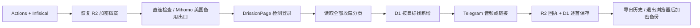

# TGMusic

把一个 YouTube Music 账号新收藏的歌发到 Telegram 私聊或已授权群组。GitHub Actions 负责浏览器和音频处理，Cloudflare D1 保存发送状态，私有 R2 保存加密登录档案，Cloudflare Worker 接收指令，Infisical Cloud 管理密钥。

默认首次只建立基线，不发送旧收藏；以后每个新目标也单独建基线。目标默认优先音频，但只有 `AUDIO_AUTHORIZED_VIDEO_IDS` 明确列出的、允许下载和重新分发的歌曲才会尝试获取文件，其余发送原链接。链接和音频在历史中分别记录。

实现来自 [Issue #1](https://github.com/C0verSnow/TGMusic/issues/1) 的最新整合需求和随笔。参考项目、选择原因与已知限制见 [设计说明](docs/design.md)，逐项验收见 [验收清单](docs/acceptance.md)。

## 运行流程



## 首次部署

### 1. 准备 Cloudflare

1. 建立私有 R2 桶，例如 `tgmusic-private`。不要启用公开访问或公开域名。R2 有免费额度，但首次开通会要求接受按量计费订阅。
2. 建立 D1 数据库 `tgmusic`，把 UUID 写进 `worker/wrangler.toml` 的 `database_id`；填写桶名。
3. 创建 R2 对象读写凭证，只授权这一个桶。另建 Cloudflare API Token，只授予对应账号的 D1 Edit。同步程序不需要 Cloudflare 全局 API Key。
4. 在 Cloudflare 控制台执行 `migrations/0001_initial.sql`，或在具备 Cloudflare 授权的部署环境执行：

   ```sh
   npx wrangler@4.45.0 d1 migrations apply tgmusic --remote --config worker/wrangler.toml
   ```

迁移只创建表，不会把丢失状态自动当成首次运行。部署命令应在你自己的部署环境或远端执行；本仓库约定禁止本地编译验证。

### 2. 准备 Infisical

建立专用项目 `youtube-music-telegram-sync`，保留 dev / staging / prod 环境。在 prod 建立：

| 目录 | 放什么 |
|---|---|
| `/shared` | R2_ENDPOINT、R2_BUCKET、CLOUDFLARE_ACCOUNT_ID、CLOUDFLARE_D1_DATABASE_ID |
| `/github-actions` | 引入 shared；R2 凭证、D1 API Token、PROFILE_ENCRYPTION_KEY、Telegram Token/Owner/默认私聊 ID、浏览器及同步配置、备用 Mihomo YAML |
| `/cloudflare-worker` | Telegram Token、Owner ID、Webhook Secret、GITHUB_WORKFLOW_TRIGGER_TOKEN |

完整键名见 [.env.example](.env.example)。示例文件不是实际密钥，不要提交 `.env`、浏览器目录或 Mihomo 节点配置。

Actions 使用独立 Machine Identity，只允许读取 prod `/github-actions`；共享值通过目录导入注入，不给它整个项目的读取权限。Worker 使用独立的 Cloudflare Workers Secret Sync，源路径限制为 prod `/cloudflare-worker`，不复用 Actions Identity。Infisical 连接 Cloudflare 的集成凭证也应限制在本 Worker 所需权限。

`PROFILE_ENCRYPTION_KEY` 是 Fernet 密钥，可在可信配置环境运行下面的密钥生成命令，并直接保存到 Infisical，勿贴到公共日志：

```sh
python -c 'from cryptography.fernet import Fernet; print(Fernet.generate_key().decode())'
```

`TELEGRAM_OWNER_ID`、`TELEGRAM_DEFAULT_CHAT_ID` 均为数字 ID。首次默认目标必须是已对 Bot 发过 `/start` 的私聊；群组以后用 `/addtarget` 授权。

### 3. 初始化数据与登录档案

先在可信的配置环境使用 Infisical 注入完整配置，显式初始化一次：

```sh
python src/infisical_boot.py src/manage.py bootstrap
```

初始化会在 R2 和 D1 写同一安装标识、建立 D1 Owner 和默认目标。只有这里可以创建首次运行状态。若中途失败，保留现场，核对 R2 `sync/installation.json` 与 D1 `installation`，不要重置生产历史。空安装可在明确确认没有发送历史后手工修复初始化；正常运行不会替你清空数据。

Google 首次登录需要人工完成。使用**有桌面的 Linux 环境**、独立浏览器用户目录，以及与 Runner 兼容的 Chrome 版本。设 `BROWSER_HEADLESS=false` 和实际 `BROWSER_PATH`，运行：

```sh
python src/infisical_boot.py src/manage.py login
```

在打开的独立 Chromium 窗口登录 Google，进入 YouTube Music，回到终端按回车。程序验证登录、关闭浏览器，再加密上传档案。不要导入日常 Chrome 的整个个人档案。macOS/Windows 的 Cookie 加密通常不能直接迁移到 Linux Runner；此步骤应在 Linux 完成。

没有远程桌面的 Xvfb 只提供虚拟显示，不能代替人工完成 Google 登录、验证码或二次验证。Google 在新出口上可能再次要求验证，这属于部署验收的一部分。

### 4. 配置 GitHub

Repository Secrets 只保存：

- `INFISICAL_CLIENT_ID`
- `INFISICAL_CLIENT_SECRET`

Repository Variables 设置项目 ID、环境 prod、路径 `/github-actions`、API 地址；完成初始化后才设 `TGMUSIC_ENABLED=true`。其他运行参数放 Infisical。手动执行 **YouTube Music Sync** 验收恢复、登录、列表及基线；下次新增一首歌验证发送。

cron 每 5 分钟唤醒一次，实际是否同步由 D1 `last_success` 和 `SYNC_INTERVAL_MINUTES` 决定，默认 60 分钟；手动 `/sync` 不等待间隔。Admin 在私聊只触发其授权目标，在群组只触发当前群组；Owner 在私聊可触发全部目标。局部同步不推迟其他目标的定时任务。GitHub 定时可能延迟，不保证精确时间。未设置 `TGMUSIC_ENABLED=true` 时任务跳过，防止配置未齐就自动运行。

工作流固定 Python 3.12、DrissionPage 4.1.1.4、Mihomo 1.19.34、Infisical CLI 0.45.6。二进制安装脚本核对仓库内固定的 SHA-256。Actions 只给 `contents: read`，30 分钟超时，同一并发组不取消正在进行的任务。

### 5. 部署 Worker

在 `worker/wrangler.toml` 填好 D1 UUID、R2 桶和 Bot 用户名，在有授权的部署环境执行：

```sh
npx wrangler@4.45.0 deploy --config worker/wrangler.toml
```

随后在 Infisical 为该 Worker 配置 Cloudflare Workers Secret Sync，从 prod `/cloudflare-worker` 同步四个敏感键。使用单独且最小权限的集成连接；不要在仓库写 Worker Secrets。`GITHUB_WORKFLOW_TRIGGER_TOKEN` 是只允许本仓库 Actions Write 的细粒度令牌，用于触发 `sync.yml`，不能用工作流里只读的 `GITHUB_TOKEN` 替代。

在可信配置环境注入 Telegram Token 和 Webhook Secret 后注册：

```sh
python src/infisical_boot.py src/manage.py set-webhook https://你的Worker域名/webhook
```

此命令还读取管理配置，可将 Webhook Secret 临时作为配置环境变量注入，勿通过命令行传秘密。Worker 收到请求后快速返回，后台处理权限和触发任务，不运行浏览器或下载音乐。

## 指令与授权

| 指令 | 用法 | 谁能用 |
|---|---|---|
| `/start` `/help` | 帮助 | 所有人 |
| `/status` | 最近同步与目标状态 | Owner / Admin |
| `/sync` | 请求一次 Actions 任务 | Owner / Admin |
| `/targets` | 查看目标；Admin 只看到授权范围 | Owner / Admin |
| `/addtarget` | `/addtarget -1001234567890 audio`；也可 link | Owner，且须为该群管理员 |
| `/removetarget` | `/removetarget -1001234567890`；保留历史 | Owner |
| `/enable` `/disable` | 当前目标，或指定数字 chat_id | Owner / 有该目标授权的 Admin，群组还需群管理员身份 |
| `/authstatus` | 最近一次 Google 登录检查 | Owner |
| `/health` | D1、R2 档案、任务状态 | Owner |

Bot 入群不会自动订阅。Bot 需具备发送权限，并建议设为群管理员以可靠查询其他成员的管理员身份。系统 Admin 与 Telegram 群管理员是两个独立条件。授权名单保存在 D1，以数字 User ID 认证，不使用用户名认证。每个用户在同一聊天的管理命令间隔至少 10 秒；Webhook update_id 去重；管理请求写脱敏审计记录。

管理员授权通过可信配置环境操作，不开放 Guest 自助提权：

```sh
python src/infisical_boot.py src/manage.py grant-admin 123456789 -1001234567890
```

## 发送、失败与恢复

- D1 主键是 `(chat_id, video_id)`。`baseline` 只是忽略首次旧收藏，不能当成“发送成功”；`sent` 还包含实际 `delivery_mode=audio|link` 和 Telegram message_id。
- 单首歌曲或单个目标被 Telegram 明确拒绝时记 failed，继续其他歌曲；以后重试。429 按 retry_after 重试，最多三次，单次等待不超过 60 秒。
- 建连超时确认尚未发送时最多重试三次；响应超时和 Telegram 5xx 可能发生在服务器已经收下消息之后，不能盲目重发，保留 pending 并提醒 Owner。
- 成功后先在 R2 写逐首回执，再写 D1。D1 写失败时，下次读取回执补齐状态，不再次发送。R2 回执也写失败则保留 pending 等人工核对。
- 人工确认 Telegram 已收到，填真实 message_id 和实际发送类型：

  ```sh
  python src/infisical_boot.py src/manage.py reconcile -1001234567890 abcdefghijk --sent-message-id 456 --mode link
  ```

- 人工确认 Telegram 没收到，才明确允许重试：

  ```sh
  python src/infisical_boot.py src/manage.py reconcile -1001234567890 abcdefghijk --retry
  ```

Telegram Bot API 不提供任意聊天历史查询，无法承诺跨 Telegram 与 D1 的严格事务或自动核对所有不确定结果。

收藏分页必须完整读完才修改歌曲状态。R2/D1 不可用、安装标识不一致、历史数量异常、登录 UNKNOWN 会停止；EXPIRED 会通知 Owner，保留旧档案。浏览器退出后才归档，过滤缓存和 Singleton 锁文件，Fernet 提供认证加密，SHA-256 校验内容；新版本使用 ETag 条件覆盖，并保留独立加密旧版本。正常运行和登录维护共用 D1 租约，避免同时更新档案。

## 网络与音频

`MIHOMO_ENABLED=auto` 默认先访问 YouTube Music；首页可访问但私有接口失败时也会尝试备用 Mihomo。`true` 强制代理，`false` 不启用备用。备用配置须含 TUN mixed、自动路由、自动网卡、rule 模式和有效规则。填写明确的 `MIHOMO_SELECT_GROUP` 与 `MIHOMO_US_NODE`，程序切换后核对出口为 US。仅启动/停止 Mihomo 使用 sudo。

进入代理模式后，Python 请求和 Chromium 都固定使用本机代理端口；Mihomo 掉线会请求失败，不回退直连。配置文件权限 0600，退出删除，节点及控制器密钥不输出日志。`MIHOMO_CONTROLLER_URL` 必须与 YAML 匹配，TUN 网卡名默认 Meta，可在 YAML `tun.device` 指定。

收藏优先使用浏览器凭据 + Innertube browse 分页，接口不兼容时才尝试 ytmusicapi。音源通过 player 接口选择音频码率；签名加密、反机器人挑战或不可播放的音源直接回退链接，不绕过这些限制。过期直链仅重新解析一次。文件使用 FFmpeg 实际转换成 MP3/M4A，限制 49 MB，超限回退链接。FLAC 不伪装成 MP3，当前不作为 sendAudio 播放器格式。

## 密钥轮换

Telegram Token、R2 凭证、D1 Token、Webhook Secret、Infisical Client Secret 都先在原服务生成替代值、更新 Infisical/启动凭证、验证后再撤销旧值。Webhook Secret 变化还需重新 setWebhook。

档案加密密钥轮换：暂停定时，保留原密钥到临时的 `PROFILE_PREVIOUS_ENCRYPTION_KEY`，把新密钥存 `PROFILE_ENCRYPTION_KEY`，运行：

```sh
python src/infisical_boot.py src/manage.py rotate-profile-key
```

成功后移除临时旧密钥；历史备份仍需保留对应旧密钥版本用于恢复。轮换失败保留原档案，不用错误密钥继续运行。

## 测试与当前交付边界

本仓库禁止本地构建、编译及会触发编译的测试。提交后由 [CI](.github/workflows/ci.yml) 在 GitHub 执行 Python unittest、Node 内置测试和 Worker 远端打包检查。测试用真实 SQLite 执行正式迁移和 SQL；Telegram 重试使用 CI 内的 HTTP 测试服务；云存储/发送边界使用小型替身，不复制去重业务逻辑。

自动测试不等于真实账号验收。Google 登录恢复、Runner 出口、Cloudflare 凭证、Infisical 路径隔离、Telegram 实际文件播放和 Worker 真实触发，需要按 [验收清单](docs/acceptance.md) 在部署环境执行并记录。P2 的多账号、每群独立播放列表和监控面板不在本期。
